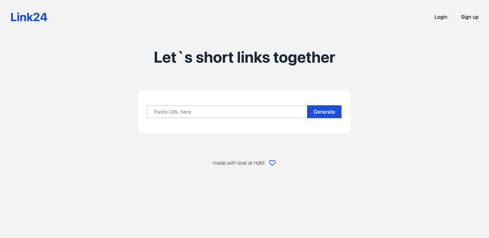
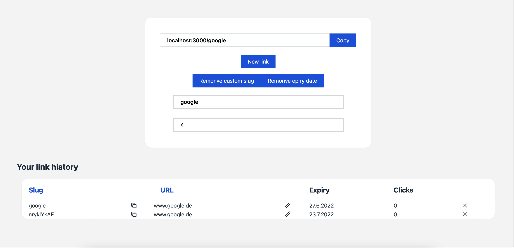
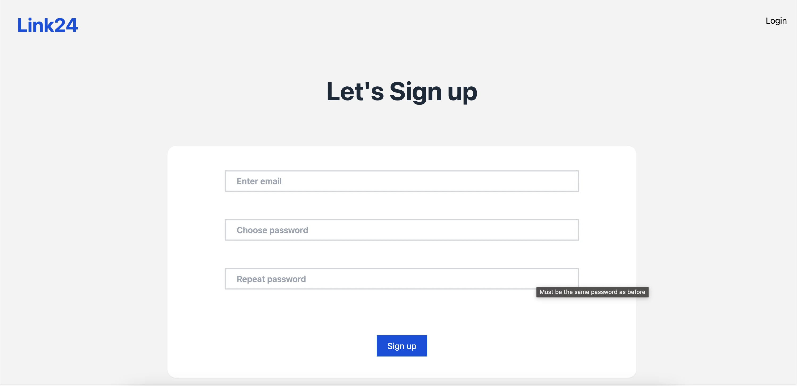

<!-- portfolio:date=2022-06-01 -->
# Link24 — Full-Stack URL Shortener

**[English](README.md) · [Deutsch](README.de.md)**

<p align="center"></p>

Ein Full-Stack-URL-Shortener mit Node.js-/Express-REST-API, MongoDB-TTL-Ablauflogik, React-/Next.js-Frontend, JWT-Authentifizierung und automatisierter GitLab-CI/CD-Pipeline.

## Highlights

- **REST-API & automatischer MongoDB-Ablauf** — `Node.js`- und `Express.js`-Backend für Short-Link-CRUD, Klick-Zähler und automatisches Löschen abgelaufener Links über Mongoose-TTL-Indizes auf `expiresAt`.
- **React-/Next.js-UI & JWT-Authentifizierung** — anonyme Kurzlinks sowie geschütztes Nutzer-Dashboard (`JWT` + `bcrypt`), benutzerdefinierte Slugs und `Tailwind CSS`-Styling.
- **End-to-End- & API-Testautomatisierung** — vereint Jest/Supertest-Backend-Tests mit Cypress-End-to-End-Tests in GitLab CI/CD und Docker Compose.

## Screenshots

<p align="center">
  
  
</p>

## Architektur

```
Next.js + React Frontend (Tailwind CSS · Cypress E2E)
         │  REST / JSON + Bearer-JWT
         ▼
Node.js / Express.js API (Jest + Supertest · bcrypt · JWT)
         │  Mongoose ODM
         ▼
MongoDB (Short-URL-Dokumente, Klick-Zähler, TTL-Index expiresAt)
```

## Tech-Stack

React · Next.js · Tailwind CSS · Node.js · Express.js · MongoDB · JWT · Docker · Cypress · GitLab CI/CD

## Einrichtung

```bash
docker compose up --build   # Startet MongoDB, Express-API und Next.js-Frontend
```
