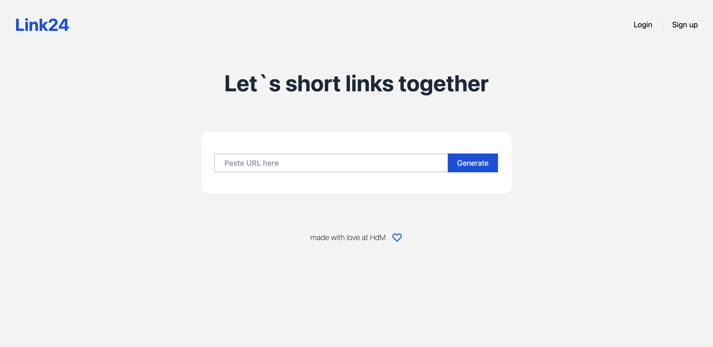
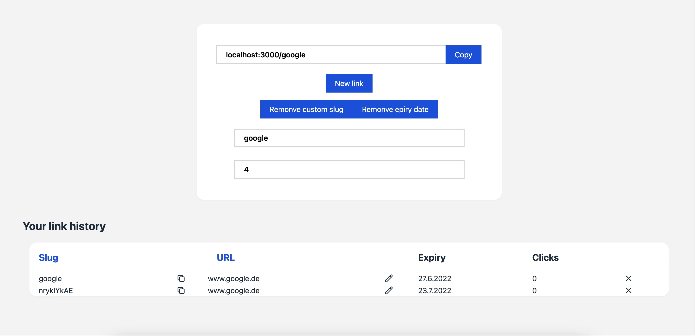
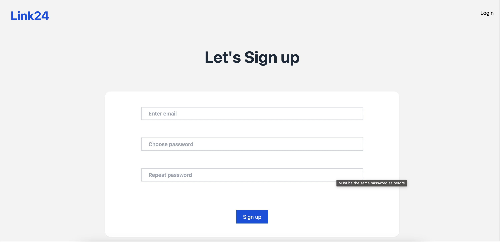

<!-- portfolio:date=2022-06-01 -->
# Link24 — Full-Stack URL Shortener

**[English](README.md) · [Deutsch](README.de.md)**

<p align="center"></p>

A full-stack URL shortener pairing a Node.js/Express REST API and MongoDB TTL storage with a React/Next.js frontend, JWT authentication, and a containerized GitLab CI/CD pipeline.

## Highlights

- **REST API & MongoDB TTL expiration** — `Node.js` and `Express.js` service layer managing short-link CRUD, click counters, and automatic link expiry via Mongoose TTL indexes on `expiresAt`.
- **React / Next.js UI & JWT auth** — anonymous short-link generation alongside authenticated user dashboards (`JWT` + `bcrypt`), custom slugs, and `Tailwind CSS` styling.
- **End-to-end & API test automation** — combines Jest/Supertest backend tests with Cypress end-to-end browser tests orchestrated in GitLab CI/CD and Docker Compose.

## Screenshots

<p align="center">
  
  
</p>

## Architecture

```
Next.js + React Frontend (Tailwind CSS · Cypress E2E)
         │  REST / JSON + Bearer JWT
         ▼
Node.js / Express.js API (Jest + Supertest · bcrypt · JWT)
         │  Mongoose ODM
         ▼
MongoDB (short URL documents, click counters, TTL expiresAt index)
```

## Tech Stack

React · Next.js · Tailwind CSS · Node.js · Express.js · MongoDB · JWT · Docker · Cypress · GitLab CI/CD

## Getting Started

```bash
docker compose up --build   # Starts MongoDB, Express API, and Next.js frontend
```
